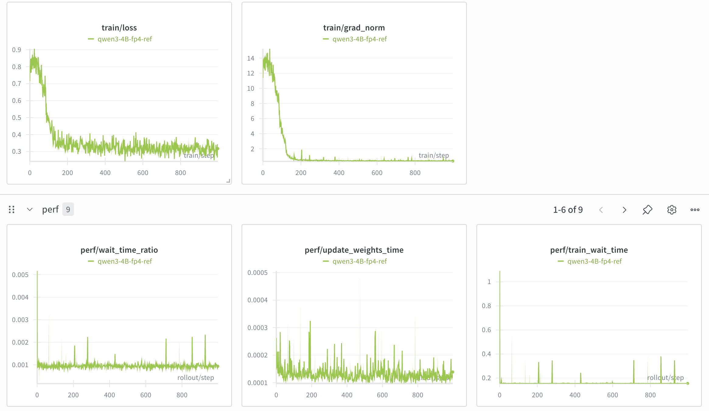

# miniTransformer

A esay transformer_engine linear framework to use quantization in model training.

## Environment Setup

How to use:

1、clone the repo with submodules:

```bash
git clone --recurse-submodules https://github.com/fy1214/miniTransformer.git
```

Or, if already cloned without submodules:

```bash
git submodule update --init --recursive
```

2、install the package and all dependencies:

```bash
pip install -e .
```

This automatically installs all required dependencies and registers the `miniTransformer` package — no manual `export PYTHONPATH` needed.

3、replace Megatron Te linear in transformer_engine.py:

```python
from miniTransformer.module.linear import Linear
class TELinear(Linear):
```

3、train with slime or other script.

## Training metric

Qwen3-4B in nvfp4_quantize_op_ref metric

