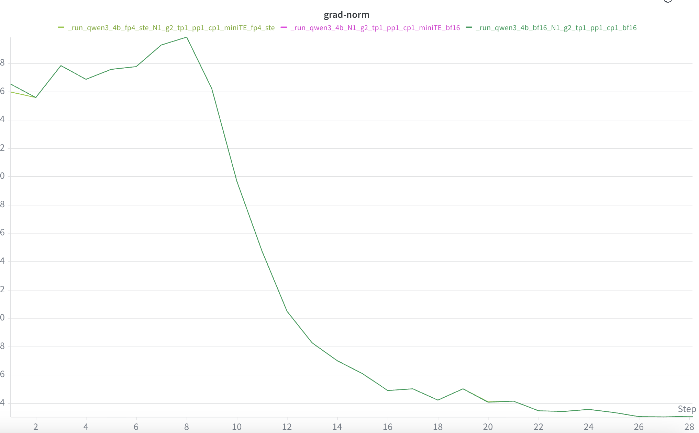
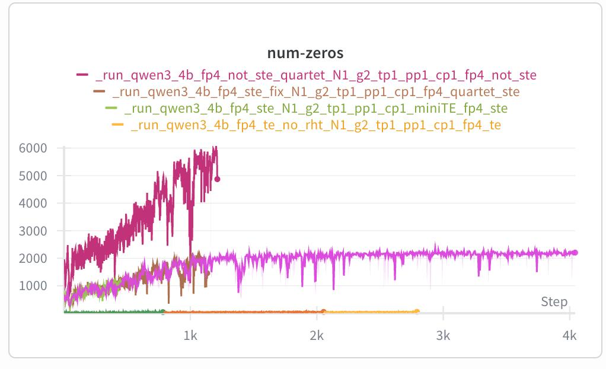

这里提供一个用于训练的脚本，根据训练结果检测替换掉的层是否能保证训练不飞。训练集需要用自己的。

在我的检查过程中，主要check以下指标：
1、loss曲线趋势，是否能达到和TransformerEngine下同样的趋势，这个曲线直接关联了你的quant和gemm是否实现正确。如果训出来的lm_loss曲线趋势都不一样，直接死刑。

2、grad norm曲线趋势，是否能达到和TransformerEngine下同样的趋势, 在loss趋势相近的情况下，这个曲线也从另一个角度关联了你的quant和gemm是否实现正确。尤其需要看齐前面30～50个step下趋势是否一致
例如：

图中_run_qwen3_4b_bf16_N1_g2_tp1_pp1_cp1_bf16是TE中bf16预训练的前27个step
_run_qwen3_4b_fp4_ste_N1_g2_tp1_pp1_cp1_miniTE_fp4_ste是在miniTE中实现的fp4 ste功能，即开启了DISABLE_BACKWARD_QUANT(QAT_PARAM=4)
run_qwen3_4b_N1_g2_tp1_pp1_cp1_miniTE_bf16 是在miniTE中实现的bf16(QAT_PARAM=1)

3、num zeros曲线，这个主要是由accumulate wgrad实现导致的, 尽量让num zeros指标维持在<100以内，和TransformerEngine在一个数量级上。 这个指标主要是检查accumulate是否实现正确。例如：

这个问题基本定位在wgrad的计算上，因为精度问题导致小数都被置成0，累加在main_grad上导致num-zeros增加。因此需要检查你的wgrad的gemm计算是否能在accumulate 上进行累加