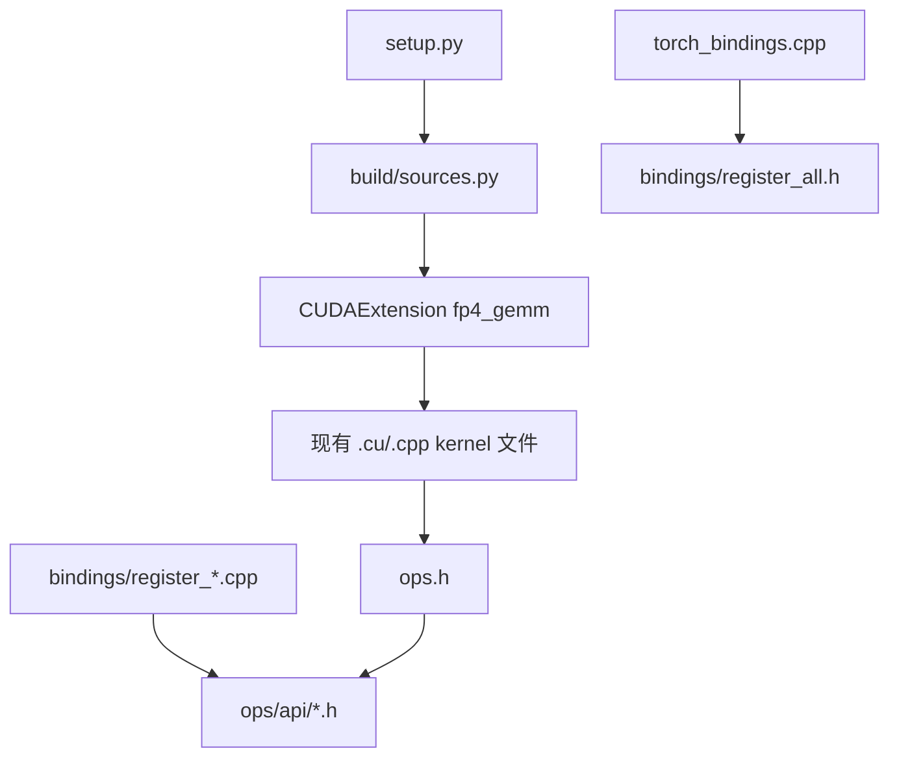

# miniTransformer csrc 第一阶段重构计划

> **执行方式：** 按任务顺序推进；每个任务完成后单独验证编译与绑定导出，不跨任务大改。
>
> **目标：** 只整理 `setup.py`、`ops.h`、`torch_bindings.cpp` 及其直接支撑文件，让编译边界、声明组织和 Python 绑定注册变得清晰。
>
> **硬约束：** 不删除任何 kernel / 逻辑代码；不修改任何 Python 可见符号名；不改变 `fp4_gemm` 扩展模块名。

---

## 1. 背景与问题

当前 `csrc` 的主要混乱不在单个 kernel 算法，而在三层“外壳”纠缠在一起：

| 层级 | 文件 | 问题 |
|------|------|------|
| 编译入口 | `setup.py` | 递归 glob 全量收集 `.cpp/.cu`，无分组、无白名单 |
| 声明总表 | `ops.h` | 438 行、43 个公开符号混在一个头文件 |
| 绑定注册 | `torch_bindings.cpp` | 160 行 `m.def` 堆叠，稳定/实验/legacy 无分层 |

Python 侧大量直接 `import fp4_gemm`，因此第一阶段必须保证：

- 模块名仍是 `fp4_gemm`
- 所有现有 `fp4_gemm.<symbol>` 名称保持不变
- 编译产物行为不变（允许内部文件移动，但不改算法）

---

## 2. 第一阶段目标架构

### 2.1 目标目录结构（新增文件，不删旧 kernel）

```text
miniTransformer/csrc/
├── ops.h                          # 保留：改为 umbrella header
├── torch_bindings.cpp             # 保留：改为薄入口
├── source_manifest.py             # 新增：显式源码清单（不放 build/，该目录已被 gitignore）
├── ops/
│   └── api/                       # 新增：按领域拆分声明
│       ├── fp4_quantize.h
│       ├── fp4_gemm.h
│       ├── fp8_quantize.h
│       ├── fp8_gemm.h
│       ├── fp4_quarter.h
│       └── common.h               # swizzle 等 utility
└── bindings/                      # 新增：分组注册
    ├── register_all.h
    ├── register_fp4_quantize.cpp
    ├── register_fp4_gemm.cpp
    ├── register_fp8_quantize.cpp
    ├── register_fp8_gemm.cpp
    ├── register_fp4_quarter.cpp
    └── register_utils.cpp
```

现有 `ops/fp4/**`、`ops/fp8/**`、`util/**` **全部保留原位**，第一阶段不搬 kernel 文件。

### 2.2 依赖关系



### 2.3 API 分层约定（只标注，不删）

在 `ops/api/*.h` 和 `bindings/register_*.cpp` 中，用注释块给每个符号打标签：

| 标签 | 含义 | 例子 |
|------|------|------|
| `STABLE` | 生产路径，Python wrapper 默认使用 | `rtn_fp4_group_pertoken` |
| `BENCH` | 仅 benchmark / A/B 对比 | `*_legacy_per_row` |
| `ALT` | 合法替代实现，按场景选择 | `*_chunked_hw`, `*_evt` |
| `UTIL` | 工具类接口 | `swizzle_scaling_factors`, `fp4_perrow_amax_te` |

第一阶段只做标注，不做 API 收口。

---

## 3. 任务分解

### Task 1：显式编译清单（`setup.py` + `build/sources.py`）

**改动文件：**
- 修改：`setup.py`
- 新增：`miniTransformer/csrc/source_manifest.py`

**做法：**

1. 在 `sources.py` 中定义分组常量：

```python
COMMON_CPP = [...]
UTIL_SOURCES = [...]
FP4_QUANTIZE_SOURCES = [...]
FP4_GEMM_SOURCES = [...]
FP8_QUANTIZE_SOURCES = [...]
FP8_GEMM_SOURCES = [...]
BINDING_SOURCES = [...]

def all_csrc_sources() -> list[str]:
    return (
        COMMON_CPP + UTIL_SOURCES + FP4_QUANTIZE_SOURCES
        + FP4_GEMM_SOURCES + FP8_QUANTIZE_SOURCES
        + FP8_GEMM_SOURCES + BINDING_SOURCES
    )
```

2. `setup.py` 改为通过 `importlib` 加载 `miniTransformer/csrc/source_manifest.py`（不依赖已安装的 package）：

```python
sources_mod = _load_csrc_sources()
sources_mod.assert_manifest_covers_glob()
sources = sources_mod.all_csrc_sources()
```

3. 保留现有 flag / arch / Blackwell gating 逻辑，只把 `glob.glob` 替换为显式列表。

4. 编译时打印分组统计（可选）：

```text
[mini-TE] csrc sources: common=2 fp4_quant=12 fp4_gemm=5 fp8_quant=3 fp8_gemm=1 bindings=6 total=29
```

**验收：**
- `pip install -e . --no-build-isolation` 成功
- `python -c "import fp4_gemm; print(len(dir(fp4_gemm)))"` 可导入
- 显式清单与当前 glob 结果文件集合一致（可用脚本 diff 校验）

---

### Task 2：拆分 `ops.h` 为领域头文件（保持兼容）

**改动文件：**
- 修改：`miniTransformer/csrc/ops.h`
- 新增：`miniTransformer/csrc/ops/api/*.h`

**拆分规则：**

| 新头文件 | 迁入声明 |
|----------|----------|
| `fp4_quantize.h` | `quantize_transpose_nvfp4` |
| `fp4_gemm.h` | `cublas_gemm`, `block_scaled_matmul_nvfp4`, `cutlass_gemm`, grouped cutlass v1/v2/evt, buffer_sizes |
| `fp8_quantize.h` | 全部 `mxfp8_grouped_*_binding` |
| `fp8_gemm.h` | `mxfp8_grouped_gemm*` |
| `fp4_quarter.h` | 全部 `*_fp4*_binding`, `eden_*`, `rht_*`, `group_transform_*`, `dequant_*`, `fp4_perrow_amax_te` |
| `common.h` | 如有跨域 utility 声明（第一阶段可只放 swizzle 相关前向声明，或留空） |

**`ops.h` 最终形态：**

```cpp
#pragma once
#include "ops/api/fp4_quantize.h"
#include "ops/api/fp4_gemm.h"
#include "ops/api/fp8_quantize.h"
#include "ops/api/fp8_gemm.h"
#include "ops/api/fp4_quarter.h"
```

**原则：**
- 不改函数签名
- 现有 `.cu` 继续 `#include "../../../ops.h"` 或 `"ops.h"`，无需批量改 include
- 每个 API 旁加 `// [STABLE|BENCH|ALT|UTIL]` 标签

**验收：**
- 全量编译通过
- `grep` 确认无重复声明
- 现有 `.cu` 文件 include 无需修改（或仅极少数路径修正）

---

### Task 3：拆分 `torch_bindings.cpp` 注册逻辑

**改动文件：**
- 修改：`miniTransformer/csrc/torch_bindings.cpp`
- 新增：`miniTransformer/csrc/bindings/register_*.cpp`
- 新增：`miniTransformer/csrc/bindings/register_all.h`

**接口设计：**

```cpp
// bindings/register_all.h
#pragma once
#include <pybind11/pybind11.h>
namespace py = pybind11;

void register_fp4_quantize(py::module& m);
void register_fp4_gemm(py::module& m);
void register_fp8_quantize(py::module& m);
void register_fp8_gemm(py::module& m);
void register_fp4_quarter(py::module& m);
void register_utils(py::module& m);
```

```cpp
// torch_bindings.cpp
PYBIND11_MODULE(TORCH_EXTENSION_NAME, m) {
    register_utils(m);
    register_fp4_quantize(m);
    register_fp4_gemm(m);
    register_fp8_quantize(m);
    register_fp4_quarter(m);
}
```

**分组映射（43 个绑定）：**

| 注册文件 | 符号数 | 包含 |
|----------|--------|------|
| `register_utils.cpp` | 1 | `swizzle_scaling_factors` |
| `register_fp4_quantize.cpp` | 1 | `quantize_transpose_nvfp4` |
| `register_fp4_gemm.cpp` | 9 | cublas/cutlass/grouped v1/v2/evt/mxfp8 gemm |
| `register_fp8_quantize.cpp` | 5 | 全部 mxfp8 quantize binding |
| `register_fp4_quarter.cpp` | 27 | 全部 quarter/eden/rht/group fp4 |

**原则：**
- `m.def` 的字符串名、参数列表、docstring **逐字保留**
- 注册顺序可与现版不同，但建议保持与 Python 测试习惯接近
- 每个 `register_*.cpp` 顶部写清该组 API 的 STABLE/BENCH 说明

**验收：**
- `python -c` 枚举 `fp4_gemm` 公开属性，与重构前集合一致
- 现有 binding 测试可运行（见 Task 4）

---

### Task 4：验证与回归清单

**编译验证：**

```bash
cd /path/to/miniTransformer
pip install -e . --no-build-isolation
```

**绑定导出验证（建议新增脚本，可选）：**

```python
# scripts/check_fp4_gemm_bindings.py
import fp4_gemm
EXPECTED = {
    "quantize_transpose_nvfp4", "swizzle_scaling_factors",
    "cublas_gemm", "block_scaled_matmul_nvfp4", ...
}
missing = EXPECTED - set(dir(fp4_gemm))
assert not missing, missing
```

**测试子集（按改动风险排序）：**

| 优先级 | 测试文件 | 覆盖 |
|--------|----------|------|
| P0 | `tests/python/nvfp4/test_quantize_transpose_nvfp4_binding.py` | FP4 quantize 绑定 |
| P0 | `tests/python/mxfp8/test_mxfp8_grouped_quantize.py` | FP8 quantize 绑定 |
| P1 | `tests/python/nvfp4/grouped_cutlass_gemm/test_grouped_cutlass_gemm_per_token_scale.py` | grouped GEMM |
| P1 | `tests/python/nvfp4/group_quantize_nvfp4_pertoken_swizzled/test_nvfp4_group_pertoken_pad_fuse.py` | quarter/group fp4 |

> 若当前环境无 GPU / 无 `python`，至少完成编译 + 绑定名一致性检查。

---

## 4. 明确不做的事（第一阶段）

以下动作**不在本阶段范围**，需你后续明确批准：

1. 删除 `legacy_per_row`、`bench only` 等入口
2. 合并 `gemm_grouped_cutlass.cu` / `v2` / `v2_evt` 实现
3. 抽取共享 `TORCH_CHECK` / Blackwell gate helper 到 `.cu` 层
4. 修改 Python wrapper（`miniTransformer/ops/*`）调用方式
5. 将 `fp4_gemm` 重命名或拆成多个扩展模块

---

## 5. 风险与缓解

| 风险 | 缓解 |
|------|------|
| `sources.py` 漏列文件导致链接失败 | 用脚本对比 glob 结果与 manifest，CI 中加 check |
| 拆分 `ops.h` 后 include 路径问题 | `ops.h` 保持 umbrella，旧 include 不改 |
| 绑定注册顺序变化影响极少数测试 | 导出集合 diff 校验 |
| 新增 `.cpp` 导致编译时间略增 | 可接受；bindings 文件很小，增量有限 |

---

## 6. 建议提交粒度

每个 Task 单独 commit，便于回滚：

1. `refactor(build): replace csrc glob with explicit source manifest`
2. `refactor(ops): split ops.h into domain api headers`
3. `refactor(bindings): group torch_bindings registration by domain`
4. `test(build): add fp4_gemm binding export check`（可选）

---

## 7. 第二阶段预览（待第一阶段完成后）

第一阶段稳定后，再进入 kernel 层整理：

1. `bindings/checks.h` — 集中 `TORCH_CHECK` 模板
2. `bindings/blackwell_gate.h` — 统一 Blackwell fallback
3. FP4 grouped quantize 族共享 launch helper
4. FP8 chunked / rowwise 共享 E8M0 math helper
5. grouped GEMM v2 / v2_evt 共享 metadata fill

每一簇仍遵循：**先抽 helper，不合并 kernel body，不删代码**。

---

## 8. 执行确认

如果你认可这份计划，建议从 **Task 1（显式编译清单）** 开始实施。  
Task 1 风险最低、收益最直接，且能为后续绑定/声明拆分提供稳定基线。
